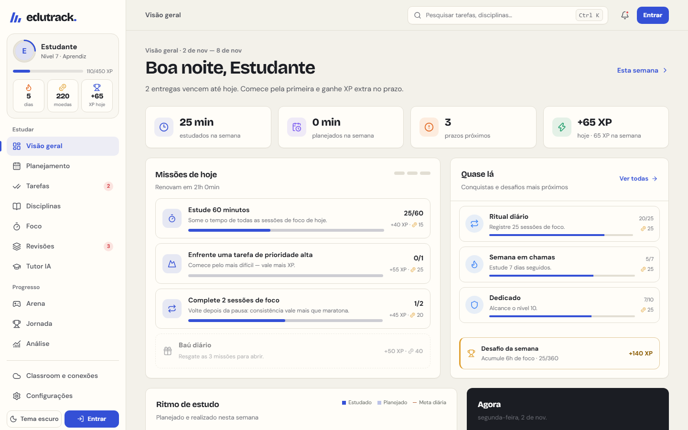
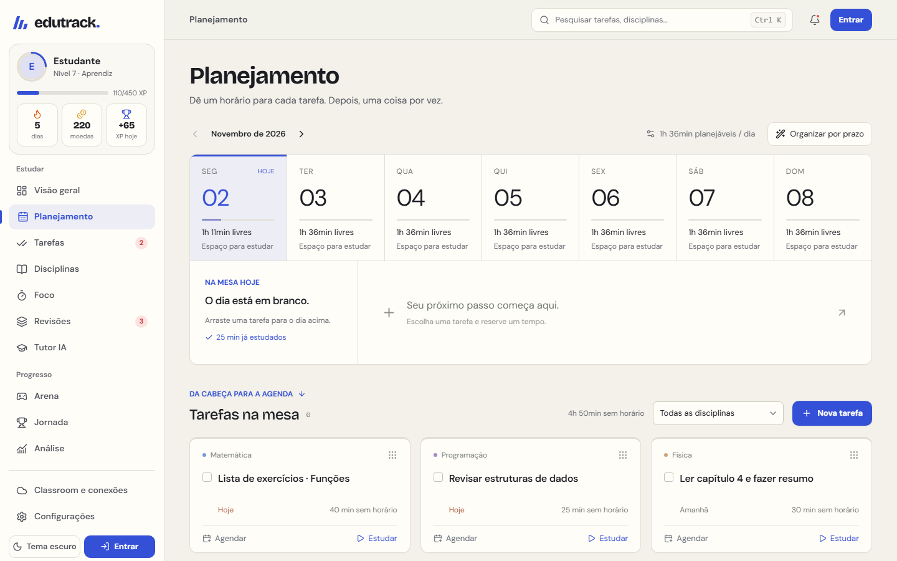
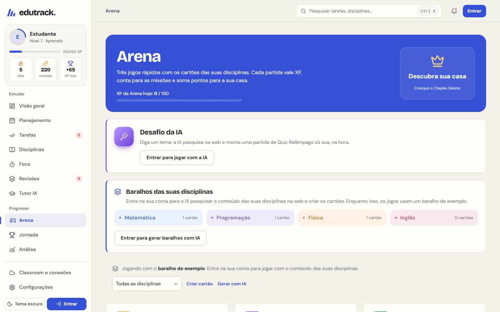
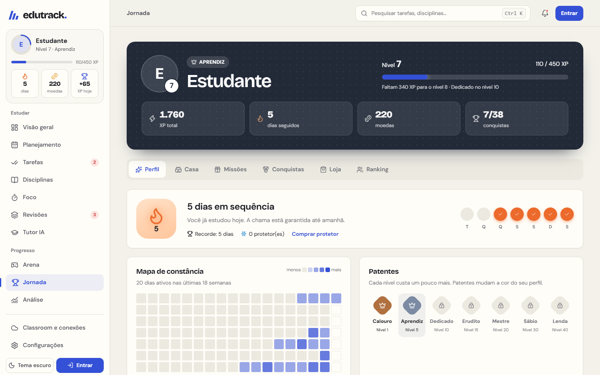
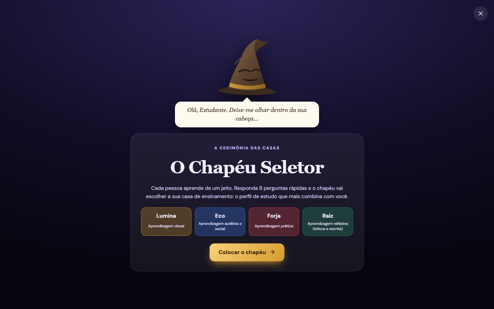
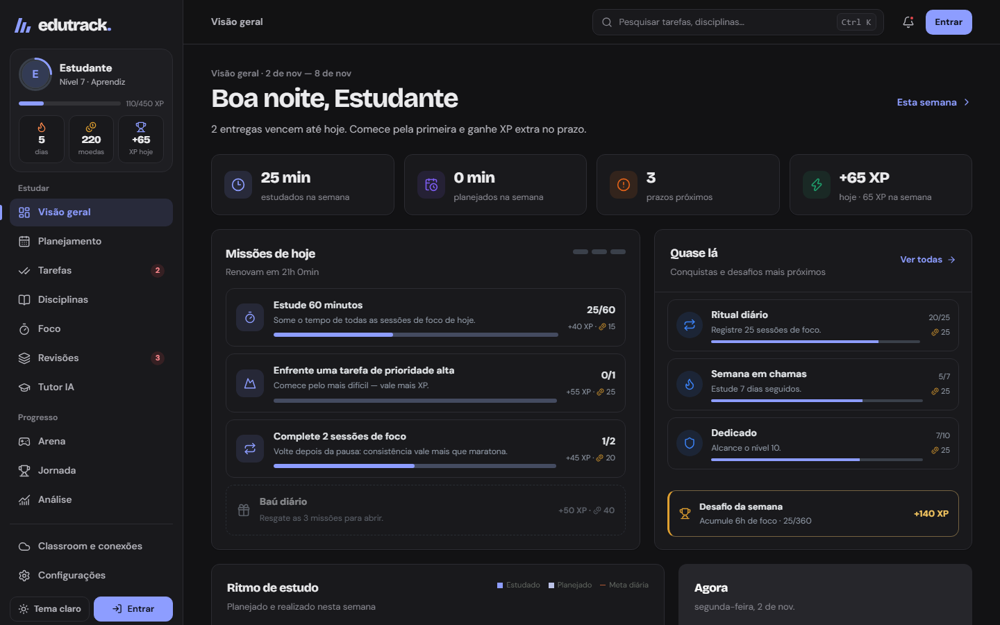
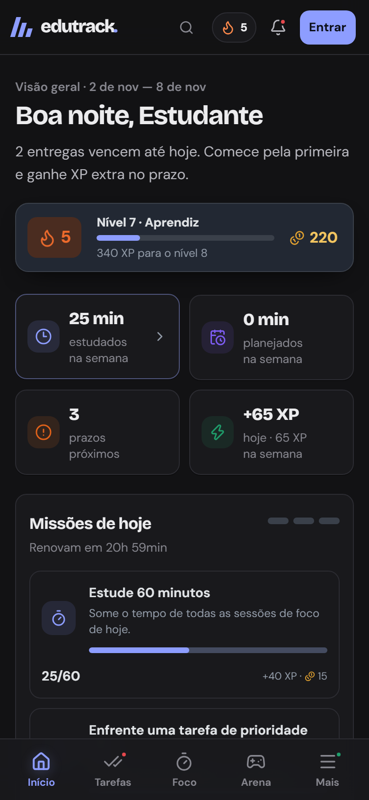
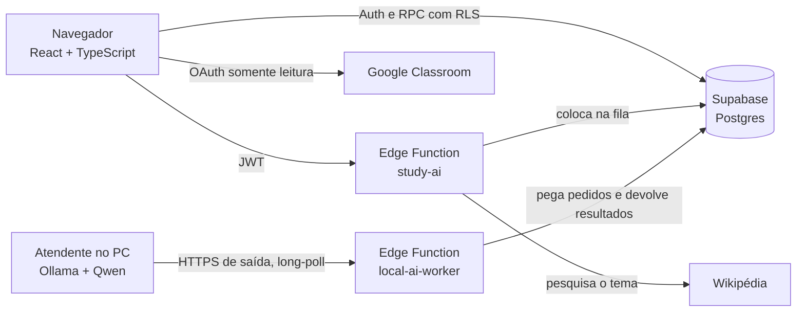

# EduTrack AI

Organizador de estudos gamificado, com um tutor de IA que pesquisa o tema antes de gerar qualquer material.

[](https://github.com/GustavoAugustin2607/edutrack-ai/actions/workflows/ci.yml)

**[Abrir o app](https://edutrack-ai-gugaa-2026.netlify.app)** · clique em **Explorar demonstração** para testar sem criar conta.



## O problema

Estudar em dia exige três coisas que costumam ficar separadas: saber o que fazer agora, ter tempo reservado para isso e manter a constância. O EduTrack junta prazos, agenda, foco e revisão em um só lugar e transforma o que o aluno realmente estudou em progresso visível.

## O que ele faz

- **Planejamento semanal** com capacidade realista: reserva 20% do dia, inclui pausas, valida sobreposição e aceita arrastar e soltar.
- **Modo foco** com cronômetro que sobrevive a recarregar a página, porque calcula o tempo pelo relógio real.
- **Revisões espaçadas** com intervalos de 1, 3, 7, 14 e 30 dias.
- **Gamificação** com XP, níveis, sequência, missões, 38 conquistas, moedas, loja e ranking opcional.
- **Quatro casas de aprendizagem**, definidas por um questionário de 8 perguntas logo após o cadastro.
- **Arena** com três jogos que usam os cartões das disciplinas do próprio aluno.
- **Tutor IA** que gera quizzes, flashcards, explicações e planos, sempre com revisão do aluno antes de salvar.
- **Google Classroom** com importação somente leitura de disciplinas e atividades.
- **Exportação** em JSON, ICS e PDF, com tema claro e escuro e layout para celular.

| Planejamento | Arena |
|---|---|
|  |  |

| Jornada | Chapéu Seletor |
|---|---|
|  |  |

| Tema escuro | Celular |
|---|---|
|  |  |

## Arquitetura



| Camada | Tecnologia |
|---|---|
| Front-end | React 19, TypeScript, Vite, Tailwind 4, Base UI, GSAP |
| Back-end | Supabase: Postgres com RLS, Auth e Edge Functions em Deno |
| IA | Ollama com Qwen, rodando em GPU local |
| Hospedagem | Netlify |
| Qualidade | Playwright, oxlint, TypeScript estrito, GitHub Actions, OpenSpec |

## Decisões técnicas

| Decisão | Por quê | Custo aceito |
|---|---|---|
| Um documento JSON por aluno, com revisão otimista | Salvar é atômico, e duas abas não sobrescrevem uma à outra em silêncio: a segunda gravação recebe erro `40001`. | Cada gravação envia o documento inteiro, com limite de 2 MiB. |
| XP calculado, nunca gravado | Não existe contador para dessincronizar. Se o aluno apaga um registro, o XP daquele registro some junto. | O total é recalculado a partir do histórico. |
| IA local sem abrir portas | O PC só faz requisições de saída para uma fila privada, com token próprio guardado como hash. Long-poll reduz a espera e o número de chamadas. | O Tutor só responde com o PC ligado. |
| Pesquisar antes de gerar | Modelos pequenos erram quando dependem da memória, então até 3 trechos da Wikipédia entram como fonte e aparecem para o aluno. | A cobertura depende do que a Wikipédia tem sobre o tema. |
| Cadastro por Edge Function | Evita o limite de envio de e-mail do serviço padrão, e o aluno entra na hora. | O e-mail não é verificado. |

## Segurança

- Row Level Security nas tabelas com dados de alunos.
- O navegador recebe apenas a chave publishable. A chave `service_role` e o token do atendente ficam fora do repositório.
- As tabelas da fila de IA não têm acesso direto pelo navegador, e as RPCs só rodam com `service_role`.
- O token do Google fica só na memória da sessão, e a integração nunca escreve no Classroom.

## Qualidade

A cada push, o GitHub Actions roda typecheck, lint, build, validação das especificações e os 21 testes de ponta a ponta com Playwright. Eles cobrem tarefas, disciplinas, agenda, foco, revisões, gamificação, Arena, exportação em PDF e layout no celular.

O comportamento esperado está documentado em [`openspec/specs`](openspec/specs), com 16 funcionalidades, 69 requisitos e 95 cenários. O modelo de dados e as APIs estão em [`docs/dicionario-de-dados.md`](docs/dicionario-de-dados.md).

Os testes rodam no modo demonstração, então as Edge Functions e as políticas do Supabase ainda não têm teste automatizado.

## Rodar localmente

Requer Node 22.13 ou superior.

```bash
npm ci
```

```bash
npm run dev
```

O app abre em `http://localhost:3000`, e o modo demonstração funciona sem nenhuma configuração. Para rodar os testes:

```bash
npx playwright install chromium
```

```bash
npm test
```

Para usar um back-end próprio, crie um projeto Supabase, aplique em ordem `schema.sql`, `ai_schema.sql`, `local_ai.sql` e `gamification.sql` da pasta `backend/`, publique as funções de `supabase/functions/` e troque os valores em `frontend/config.ts`. O atendente de IA está em `local-ai/`.

## Estrutura

```text
frontend/               telas, regras de negócio e estilos
frontend/game.ts        motor de gamificação
frontend/model.ts       tipos, validação e métricas
frontend/scheduling.ts  regras da agenda
components/ui/          componentes base (shadcn)
supabase/functions/     study-ai, local-ai-worker e signup
backend/                schema, RLS e funções SQL
local-ai/               atendente que roda no PC
tests/                  testes Playwright
openspec/               especificações por funcionalidade
docs/                   dicionário de dados, referências e prints
```

## Limitações conhecidas

- O Tutor IA só responde quando o PC com o modelo está ligado. O resto do app funciona normalmente sem ele.
- A função de cadastro ainda não tem limite de requisições.
- O XP do ranking é enviado pelo navegador, então o ranking não é à prova de trapaça.
- O build gera um único HTML de 2,3 MB (724 KB com gzip). Dividir o código por rota é o próximo passo de performance.

## Autoria

Projeto acadêmico de Gustavo Paulino Augustin e Enzo Cardoso Mariano (Faculdade Impacta), desenvolvido com apoio de ferramentas de IA (Codex e Claude Code).
