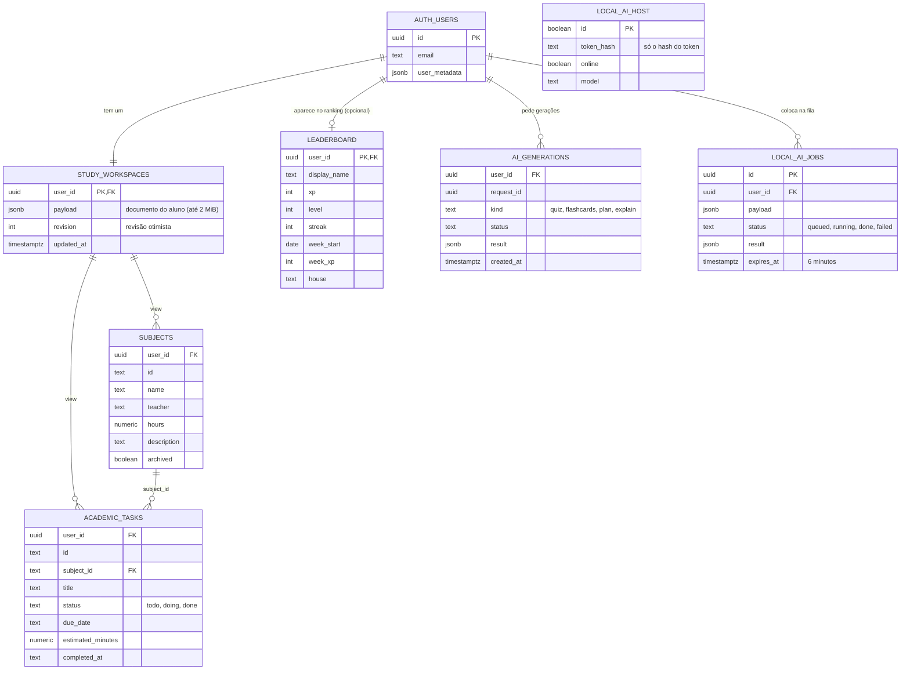

# Modelo de dados - EduTrack AI

Banco: PostgreSQL no Supabase (projeto `xtticfdiyfsgpnbudzht`). Todas as tabelas com dados de aluno têm Row Level Security.

## Diagrama

## Como o modelo funciona

- **`study_workspaces`** guarda um documento JSON por aluno com disciplinas, tarefas, sessões de foco, cartões de revisão, agenda, configurações e o campo `game`. Cada gravação passa pela RPC `save_study_workspace`, que só aceita a revisão atual e devolve erro `40001` se outra aba gravou antes.
- **`subjects`** e **`academic_tasks`** são views somente leitura sobre esse documento, com `security_invoker`, então respeitam a RLS da tabela de origem. `academic_tasks.subject_id` liga cada tarefa à disciplina.
- **`leaderboard`** é o ranking opcional: cada aluno grava só a própria linha, e o XP semanal soma a Taça das Casas.
- **`ai_generations`** registra as gerações do Tutor IA com limite por minuto e por dia, e torna repetições idempotentes.
- **`local_ai_jobs`** e **`local_ai_host`** formam a fila da IA que roda no PC: no máximo 3 pedidos ativos, 1 por aluno, com expiração em 6 minutos.

## Segurança

| Tabela | Quem lê | Quem grava |
|---|---|---|
| study_workspaces | o próprio aluno | o próprio aluno, pela RPC com revisão |
| subjects, academic_tasks | o próprio aluno | ninguém (views) |
| leaderboard | alunos logados | o próprio aluno |
| ai_generations, local_ai_jobs, local_ai_host | só o servidor (service_role) | só o servidor |

Funções: `save_study_workspace` (gravação), `search_subjects` (busca híbrida), `claim_ai_generation` (limites da IA), `enqueue_local_ai` e `local_ai_worker` (fila da IA local).

Detalhes de cada campo: [dicionario-de-dados.md](dicionario-de-dados.md). SQL: [`backend/`](../backend).
